<div align="center">


<br/>


</div>

<table>
<tr>
<td width="58%" valign="top">

## `01` — whoami

```ts
const diego = {
  role:      "Software Engineer",
  focus:     ["Distributed Systems", "APIs", "Clean Architecture"],
  languages: ["Go", "TypeScript", "Python", "PHP", "JavaScript"],
  ai:        ["Claude Code", "Codex", "MCP", "Agents", "SDD"],
  mindset:   "readable > clever · shipped > perfect",
  currently: "making things that work, work faster",
};
```

I build **backend services, APIs and data-driven systems** with a strong bias toward clean, maintainable and efficient code.

I also work across the frontend with **React, Next.js, Vue and Stimulus** when the interface has to match the system behind it.

What I enjoy most: designing robust architectures, squeezing performance, and solving the problems nobody wants to touch.

</td>
<td width="42%" valign="center">



</td>
</tr>
</table>

<div align="center">

</div>

## `02` — tech stack

<table align="center" width="100%">
<tr>
<td align="center" width="33%">
<sub><b>⚙️ CORE</b></sub><br/><br/>

<br/>

</td>
<td align="center" width="33%">
<sub><b>🎨 FRONTEND</b></sub><br/><br/>

<br/>

</td>
<td align="center" width="33%">
<sub><b>🗄️ DATA & INFRA</b></sub><br/><br/>

<br/>

</td>
</tr>
</table>

<div align="center">

</div>

## `03` — ai-augmented engineering

<div align="center">


</div>

> AI is part of my toolchain, not a shortcut around engineering. I treat agents like junior collaborators: tight specs in, reviewed diffs out.

<table align="center" width="100%">
<tr>
<td width="50%" valign="top">

**🤖 Agentic workflows**

Daily work with **Claude Code** and **OpenAI Codex** — delegating refactors, test coverage and migrations to **subagents** running in parallel, then reviewing every diff before it lands.

**🧩 Skills & custom agents**

Reusable **Skills** and scoped agent definitions that encode project conventions, review checklists and deploy steps — so the assistant follows *our* standards, not generic defaults.

</td>
<td width="50%" valign="top">

**🔌 MCP (Model Context Protocol)**

Wiring **MCP servers** to connect models to real systems — databases, internal APIs, issue trackers and docs — so context comes from the source of truth instead of a copy-paste.

**📐 SDD · Spec-Driven Development**

Spec first, code second. Executable specs and acceptance criteria drive both the implementation and the agent's scope — ambiguity gets resolved on paper, not in the diff.

</td>
</tr>
</table>

**🧠 LLM integration** — building production features on top of LLM APIs: tool calling, structured outputs, RAG pipelines, prompt caching and cost/latency tuning.

<div align="center">

</div>

## `04` — telemetry

<div align="center">


<br/><br/>


<br/><br/>


<br/><br/>


</div>

## `05` — connect

<div align="center">

<a href="https://www.linkedin.com/in/diego-palacio-3687281b6/">
  
</a>
<a href="https://github.com/Palaciodiego008">
  
</a>

<br/><br/>

<samp><b>`// systems are temporary · good abstractions are forever`</b></samp>


</div>
